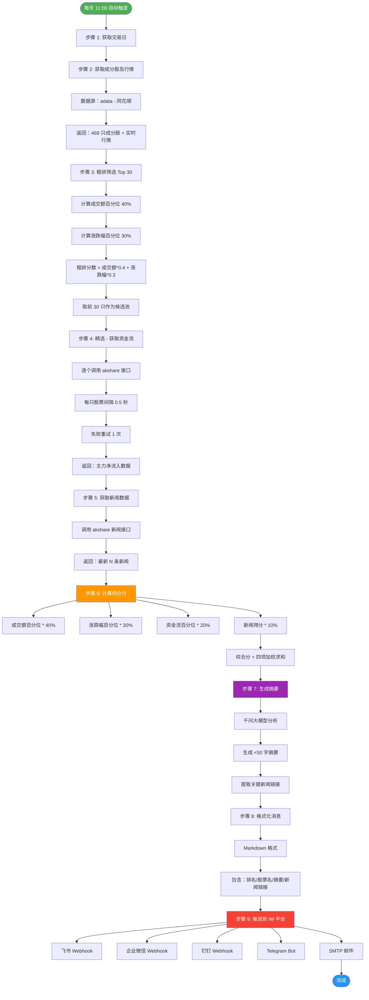

# AI 智能体股票热力榜系统 - 完整架构说明

## 📊 系统流程图



---

## 🏗️ 系统架构

### 三层架构

```
┌─────────────────────────────────────────────────────────┐
│                    应用层 (Application)                  │
│  ┌─────────────┐  ┌─────────────┐  ┌─────────────┐     │
│  │  main.py    │  │  pusher.py  │  │config.py    │     │
│  │ 主程序入口  │  │  IM 推送     │  │  配置文件   │     │
│  └─────────────┘  └─────────────┘  └─────────────┘     │
└─────────────────────────────────────────────────────────┘
                          ↕
┌─────────────────────────────────────────────────────────┐
│                    计算层 (Computation)                  │
│  ┌─────────────┐  ┌─────────────┐  ┌─────────────┐     │
│  │ scorer.py   │  │summarizer.py│  │ llm_service │     │
│  │ 综合评分    │  │ 摘要生成    │  │ 千问大模型  │     │
│  └─────────────┘  └─────────────┘  └─────────────┘     │
└─────────────────────────────────────────────────────────┘
                          ↕
┌─────────────────────────────────────────────────────────┐
│                    数据层 (Data)                         │
│  ┌─────────────┐  ┌─────────────┐  ┌─────────────┐     │
│  │ fetcher.py  │  │   adata     │  │  akshare    │     │
│  │ 数据获取    │  │  成分股 + 行情 │  │  资金流 + 新闻 │     │
│  └─────────────┘  └─────────────┘  └─────────────┘     │
└─────────────────────────────────────────────────────────┘
```

---

## 📁 代码结构

```
d:\project-test\
├── main.py                      # 主程序入口
├── src/
│   ├── config.py                # 配置文件（概念映射表）
│   ├── fetcher.py               # 数据获取层
│   ├── scorer.py                # 综合评分计算
│   ├── summarizer.py            # 摘要生成
│   ├── pusher.py                # IM 推送
│   └── llm_service.py           # 千问大模型调用
├── .github/workflows/
│   └── stock_screener.yml       # GitHub Actions 定时任务
├── .env                         # 环境变量配置
├── .env.example                 # 环境变量模板
├── requirements.txt             # Python 依赖
└── README.md                    # 部署说明
```

---

## 🔧 核心模块说明

### 1. 数据获取层 (`fetcher.py`)

**职责**：统一数据源接口

| 函数 | 功能 | 数据源 |
|------|------|--------|
| `get_concept_stocks()` | 获取成分股及行情 | adata |
| `get_candidates_stocks()` | 粗排筛选候选池 | adata |
| `get_single_stock_fund_flow()` | 获取单只股票资金流 | akshare |
| `get_stock_news()` | 获取股票新闻 | akshare |
| `get_trade_date()` | 获取最近交易日 | adata |

**关键特性**：
- ✅ 成分股接口：469 只股票，稳定
- ✅ 资金流接口：逐个调用，间隔 0.5 秒，失败重试
- ✅ 新闻接口：返回最新 N 条，链接完整可用

---

### 2. 综合评分层 (`scorer.py`)

**职责**：计算综合分并排序

**权重配置**：
```python
WEIGHT_AMOUNT = 0.40     # 成交额 40%
WEIGHT_CHANGE_PCT = 0.30 # 涨跌幅 30%
WEIGHT_NET_FLOW = 0.20   # 资金流 20%
WEIGHT_NEWS = 0.10       # 新闻 10%
# 总计：100%
```

**两阶段筛选**：
1. **粗排**：成交额 40% + 涨跌幅 30%，取前 30 只候选
2. **精选**：加上资金流 20% + 新闻 10%，计算综合分，取 Top 10

**降级策略**：
- 资金流获取失败 → 标记为 0，不剔除
- 新闻缺失 → 返回 None，不参与新闻权重计算

---

### 3. 摘要生成层 (`summarizer.py`)

**职责**：为每只股票生成 <50 字摘要

**摘要格式**：
```
{股票名} {涨跌幅}% 成交额{X}亿 主力净流入{Y}万 [最新新闻标题]
```

**示例**：
```
芒果超媒 +6.83% 成交额 37.83 亿 主力净流入 3.24 亿 [公司 AI 产品获市场认可]
```

**大模型集成**：
- 使用千问 3.5 Plus (`qwen-plus`)
- 分析新闻与"AI 智能体"的相关性
- 降级方案：关键词匹配（无 API Key 时）

---

### 4. IM 推送层 (`pusher.py`)

**职责**：推送到多个 IM 平台

**支持平台**：
| 平台 | 配置项 | 状态 |
|------|--------|------|
| 飞书 | `FEISHU_WEBHOOK_URL` | ✅ 已测试 |
| 企业微信 | `WECHAT_WEBHOOK_URL` | ⏸️ 可选 |
| 钉钉 | `DINGTALK_WEBHOOK_URL` | ⏸️ 可选 |
| Telegram | `TELEGRAM_BOT_TOKEN` | ⏸️ 可选 |
| 邮件 | `EMAIL_*` | ⏸️ 可选 |

**消息格式**（Markdown）：
```markdown
## 📈 AI 智能体 Top 10 股票热力榜

### 🏆 第 1 名：芒果超媒 (300413)
**摘要**：芒果超媒 +6.83% 成交额 37.83 亿 主力净流入 3.24 亿
**关键新闻**：[公司 AI 产品获市场认可](http://...)

### 🥈 第 2 名：中文在线 (300364)
...

📊 数据来源：同花顺/东方财富
⏰ 更新时间：2026-10-14
⚠️ 风险提示：以上内容仅供参考，不构成投资建议
```

---

## 🚀 部署说明

### 本地部署

#### 1. 环境准备
```bash
# Python 3.12+
conda create -n stock_env python=3.12
conda activate stock_env

# 安装依赖
pip install -r requirements.txt
```

#### 2. 配置环境变量
```bash
# 复制模板
cp .env.example .env

# 编辑 .env，填入：
FEISHU_WEBHOOK_URL=https://open.feishu.cn/...
DASHSCOPE_API_KEY=sk-xxxxx
```

#### 3. 运行测试
```bash
python main.py
```

---

### 云端部署（GitHub Actions）

#### 1. Fork 仓库
```
GitHub → 你的仓库 → Fork
```

#### 2. 配置 Secrets
```
Settings → Secrets and variables → Actions → New repository secret

添加：
- FEISHU_WEBHOOK_URL = https://open.feishu.cn/...
- DASHSCOPE_API_KEY = sk-xxxxx（可选）
```

#### 3. 配置 Variables
```
Settings → Secrets and variables → Actions → Variables → New repository variable

添加：
- CONCEPT_KEY = AI 智能体_同花顺
- TOP_N = 10
- CANDIDATE_N = 15
```

#### 4. 手动触发测试
```
Actions → AI 智能体 Top 10 股票热力榜 → Run workflow
```

#### 5. 验证定时任务
```
每天上午 11:00 自动运行
查看飞书群聊接收推送消息
```

---

## 📊 性能指标

| 指标 | 值 | 说明 |
|------|-----|------|
| **成分股数量** | 469 只 | AI 智能体概念板块 |
| **候选池大小** | 15-30 只 | 粗排筛选 |
| **最终返回** | 10 只 | Top 10 热度榜 |
| **API 调用次数** | ~45 次 | 15 只股票 × 3 个接口 |
| **运行时间** | 1-2 分钟 | 本地/云端一致 |
| **推送延迟** | <5 秒 | Webhook 即时推送 |

---

## 🔍 监控与日志

### 日志级别
```python
logging.basicConfig(level=logging.INFO)
```

### 关键日志
```
[步骤 1] 获取最近一个交易日...
[步骤 2] 获取 Top 10 股票（两阶段筛选）...
  阶段 1：粗排取前 15 只候选
  阶段 2：精选（资金流 + 新闻）
[步骤 3] 获取新闻数据...
[步骤 4] 生成报告...
[步骤 5] 格式化消息...
[步骤 6] 推送到 IM 平台...
  飞书：✓ 成功
  企业微信：✗ 未配置
推送完成：1 个平台成功
```

---

## ⚠️ 注意事项

### 1. 数据源风控
- **同花顺成分股**：稳定，偶发空数据（重试即可）
- **同花顺资金流**：按 IP 风控，间隔 0.5 秒降低触发概率
- **东方财富新闻**：稳定，链接完整可用

### 2. GitHub Actions 限制
- 免费账户：每月 2000 分钟
- 每次运行：1-2 分钟
- 完全够用！

### 3. 大模型调用
- 千问 API Key 可选
- 未配置时自动降级到关键词匹配
- 推荐配置以获得更好的摘要质量

---

## 📈 未来优化方向

1. **数据持久化** - 将每日结果存储到数据库，支持历史查询
2. **可视化看板** - 使用 Grafana/Metabase 展示热力榜趋势
3. **多概念支持** - 同时监控多个概念板块
4. **告警机制** - 当某只股票热度异常时自动告警
5. **工作流编排** - 使用 Apache Airflow 进行更复杂的调度

---

## 📞 技术支持

- **数据源文档**：
  - [adata 文档](https://adata.finance/)
  - [akshare 文档](https://akshare.akfamily.xyz/)

- **大模型文档**：
  - [阿里云百炼](https://bailian.console.aliyun.com/)
  - [千问 API](https://help.aliyun.com/zh/dashscope/)

- **GitHub Actions 文档**：
  - [定时任务](https://docs.github.com/en/actions/writing-workflows/choosing-when-your-workflow-runs/events-that-trigger-workflows#schedule)
  - [Secrets 管理](https://docs.github.com/en/actions/security-guides/using-secrets-in-github-actions)

---

**最后更新**：2026-10-14  
**版本**：v1.0.0
